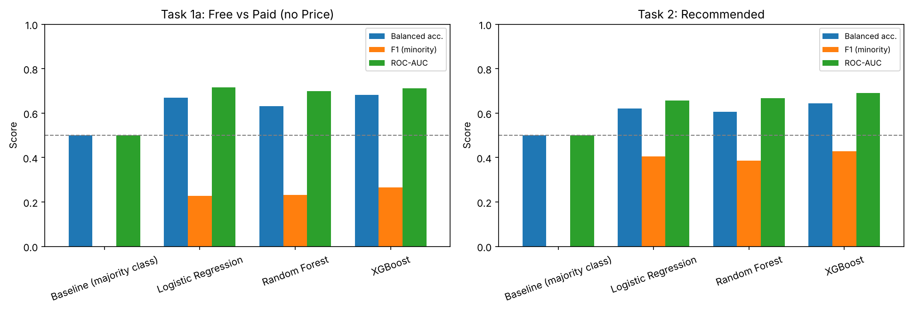

# Google Play Store App Classification

Can you predict, from information available **before an app launches**, whether it will be paid, what it will cost, and whether users will rate it highly? This project compares seven machine learning models on the Google Play Store dataset to find out, then revisits its own results to check how much of the performance was real.

Built as the team project for **CSE427: Machine Learning** at BRAC University.

📄 [Project report (PDF)](report/app_classification_report.pdf)

---

## Tasks

| Task | Question | Type |
|---|---|---|
| **1a** | Is the app free or paid? | Binary classification |
| **1b** | If paid, what is its price? | Regression |
| **2** | Is the app recommended (rating above 4.5)? | Binary classification |

**Features:** app size, category, genre, content rating (and price, for Task 2). Reviews, installs and rating were deliberately excluded because they only exist after launch, so using them would leak future information into the model.

**Models:** Logistic Regression, Linear Regression, Decision Tree, Random Forest, XGBoost, KNN (k-nearest neighbours), and hard/soft Voting ensembles.

## Repository contents

| File | What it is |
|---|---|
| [`app_classification.ipynb`](app_classification.ipynb) | The original project as submitted: EDA (exploratory data analysis), preprocessing, all models, feature importance, voting ensembles |
| [`revisited_analysis.ipynb`](revisited_analysis.ipynb) | A follow-up that fixes target leakage, adds baselines and uses imbalance-aware metrics |
| [`report/`](report/) | The submitted IEEE-format report |
| [`data/googleplaystore.csv`](data/googleplaystore.csv) | The dataset (10,841 apps) |

## Results

### As submitted

The original notebook reported near-perfect scores for Task 1 and about 81% accuracy for Task 2:

| Task | Best reported result |
|---|---|
| 1a: Free/Paid | Accuracy **1.000** (5 of 6 models) |
| 1b: Price | R² **1.000**, MAE (mean absolute error) **$0.00** (Linear Regression) |
| 2: Recommended | Accuracy **0.810** (Logistic Regression) |

### Revisited: what was actually going on

Re-examining the results after submission turned up two problems:

1. **Target leakage in Task 1.** `Price` was included as an input feature. An app is paid exactly when its price is above zero, and Task 1b *predicts* price, so the models were handed the answer.
2. **No baseline comparison.** 93% of apps are free and about 80% are not recommended, so always guessing the majority class already scores high accuracy. The original Logistic Regression's 0.810 on Task 2 was exactly that: it never predicted a single recommended app.

The [revisited notebook](revisited_analysis.ipynb) removes `Price` from Task 1, compares every model against a majority-class baseline, balances class weights, and drops apps with missing ratings from Task 2 instead of filling them with the median, which had silently labelled 1,412 apps as not recommended.



| Task | Baseline | XGBoost (best overall) |
|---|---|---|
| 1a: Free/Paid, without Price | Balanced accuracy 0.50 | Balanced accuracy **0.68**, ROC-AUC **0.71**, paid-app F1 0.27 |
| 1b: Price, without Price as input | MAE $10.33, R² −0.03 | MAE **$9.83**, R² **0.18** |
| 2: Recommended | Balanced accuracy 0.50 | Balanced accuracy **0.64**, ROC-AUC **0.69**, recommended-app F1 0.43 |

*Balanced accuracy averages recall across both classes. ROC-AUC (area under the receiver operating characteristic curve) measures how well a model ranks positives above negatives. For both, 0.5 means no better than chance.*

### Takeaways

- Launch-time features carry **weak but real signal** for whether an app is paid or highly rated, far from the perfect scores originally reported.
- **Price is essentially unpredictable** from these features: the best model barely beats always guessing the median price.
- App success depends mostly on factors this dataset doesn't capture before launch, such as quality, marketing and developer reputation.
- The broader lesson: **check for target leakage and compare against a baseline before trusting a high score.**

## Running it

```bash
git clone https://github.com/azmayeen01/google-play-app-classification.git
cd google-play-app-classification
pip install -r requirements.txt
jupyter notebook
```

Open either notebook and run all cells. Both read the dataset from `data/` and run on a normal laptop in a few minutes, with no GPU (graphics processing unit) needed.

## Dataset

[Google Play Store Apps](https://www.kaggle.com/datasets/lava18/google-play-store-apps) by Lavanya Gupta on Kaggle: 10,841 apps scraped from the Play Store, with category, rating, reviews, size, installs, type, price, content rating and genre.

## Team

| Member | Contact |
|---|---|
| **Azmayeen Aftab** | [GitHub](https://github.com/azmayeen01) · azmayeen.aftab@g.bracu.ac.bd |
| Labiba Binte Arif | [GitHub](https://github.com/labiba-23) · labiba.binte.arif@g.bracu.ac.bd |
| Naim Mahmud Peyas | naim.mahmud.peyas@g.bracu.ac.bd |

The revisited analysis was added after the course ended.
